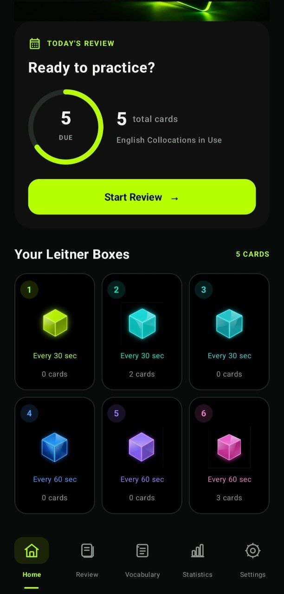
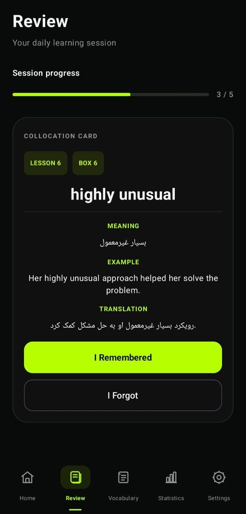
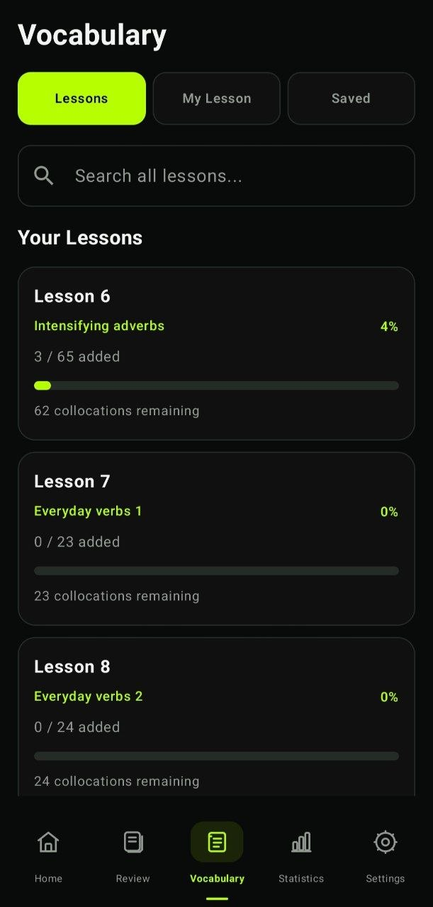
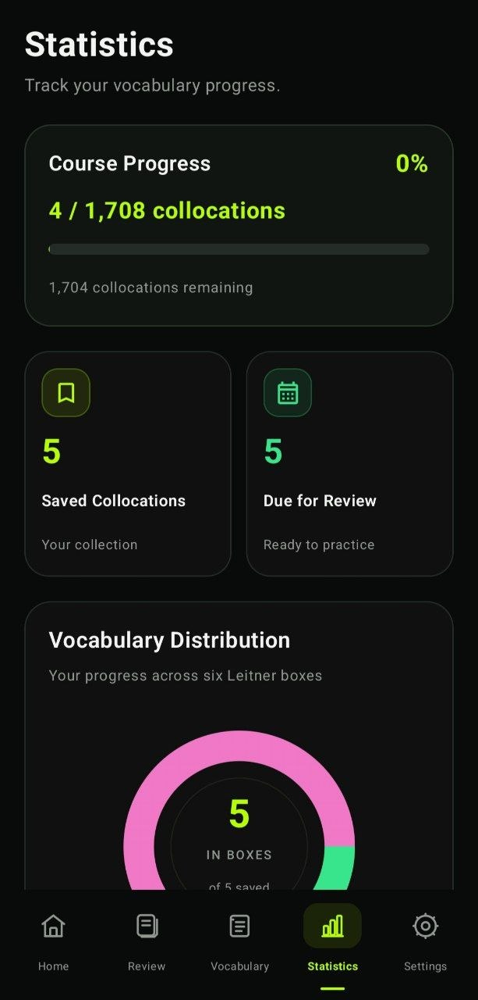
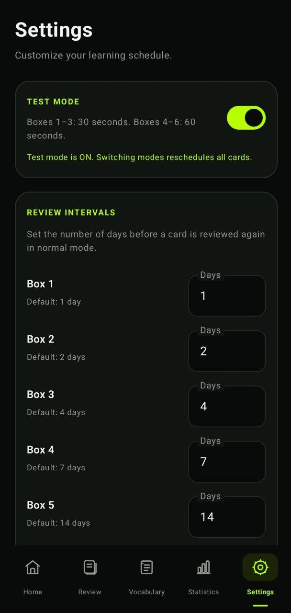

# LeitnerBox

**Learn smarter. Remember longer.**

LeitnerBox is an Android flashcard application built with **Kotlin** and **Jetpack Compose**. It implements the **six-box Leitner spaced repetition system** to help learners review vocabulary at scheduled intervals.

**Developed by Ali Hashemian**

---

## Screenshots

<p align="center">
  
  &nbsp;&nbsp;
  
</p>

<p align="center">
  
  &nbsp;&nbsp;
  
</p>

<p align="center">
  
</p>

## Overview

LeitnerBox combines a structured flashcard workflow with spaced repetition. Users can select vocabulary from lessons, create personal entries, review saved cards, and monitor their learning progress.

## Features

- Six-box Leitner flashcard system
- Configurable review intervals
- Lesson-based vocabulary selection
- Personal vocabulary creation and management
- Review sessions with recall feedback
- Learning statistics and vocabulary distribution
- Scheduled review notifications
- Test mode for accelerated scheduling during development and testing

## Leitner Review Schedule

The default review intervals are:

| Box | Interval |
|---|---:|
| Box 1 | 1 day |
| Box 2 | 2 days |
| Box 3 | 4 days |
| Box 4 | 7 days |
| Box 5 | 14 days |
| Box 6 | 30 days |

Cards progress through the boxes based on review performance. Cards that need more practice return to an earlier stage.

## Technology

- **Kotlin** — application programming language
- **Jetpack Compose** — declarative Android UI
- **SQLite (SQLiteOpenHelper)** — local database persistence
- **Android SDK** — application platform
- **JSON** — structured lesson vocabulary data
- **Android AlarmManager and Notification APIs** — scheduled review reminders

  ## Architecture

LeitnerBox follows a component-based Android application structure built with Kotlin and Jetpack Compose.

- **Presentation:** Jetpack Compose screens handle the user interface, navigation, and UI state.
- **Data Management:** SQLiteOpenHelper manages flashcard storage and database operations.
- **Lesson Data:** LessonRepository loads and validates structured vocabulary data from a local JSON asset.
- **Review Scheduling:** Android AlarmManager schedules flashcard review reminders.
- **Notifications:** BroadcastReceivers handle scheduled notifications and restore review alarms after device reboot.

The application uses local data storage and does not require a remote backend for its core functionality.

## Project Details

| Item | Value |
|---|---|
| Application | LeitnerBox |
| Package | `com.leitnerbox.app` |
| Platform | Android |
| Minimum SDK | API 24 (Android 7.0) |
| Developer | Ali Hashemian |

## Getting Started

1. Clone the repository:

   ```bash
   git clone https://github.com/ali-hashemian-dev/LeitnerBox.git
   ```

2. Open the project in Android Studio.
3. Allow Gradle synchronization to complete.
4. Build and run the application on an Android device running Android 7.0 (API 24) or higher.

### Vocabulary Dataset

The original vocabulary dataset is maintained separately and is not included in this public repository.

To build a fully functional version of the application, place the dataset file at:

`app/src/main/assets/lessons/lessons.json`

The dataset must follow the JSON structure expected by `LessonRepository`. It is distributed separately and is not included in this repository.

### Vocabulary Dataset

The original vocabulary dataset is maintained separately and is not included in this public repository.

To build a fully functional version of the application, the dataset must be placed at:

`app/src/main/assets/lessons/lessons.json`

The dataset is distributed separately and is not part of this repository.

## Releases

When a packaged APK is published, it will be available from the [GitHub Releases page](https://github.com/ali-hashemian-dev/LeitnerBox/releases).

## Author

**Ali Hashemian**  
GitHub: [@ali-hashemian-dev](https://github.com/ali-hashemian-dev)

---

*LeitnerBox is an independent Android software project.*
